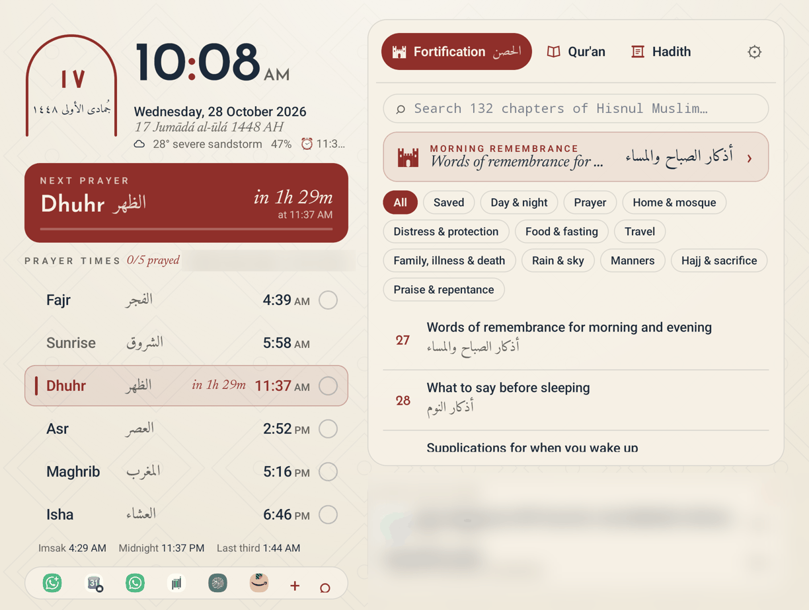
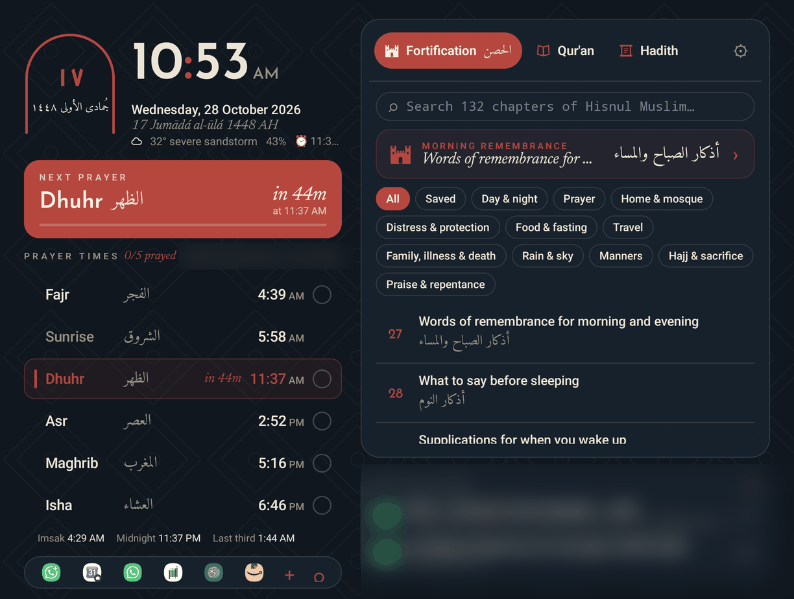
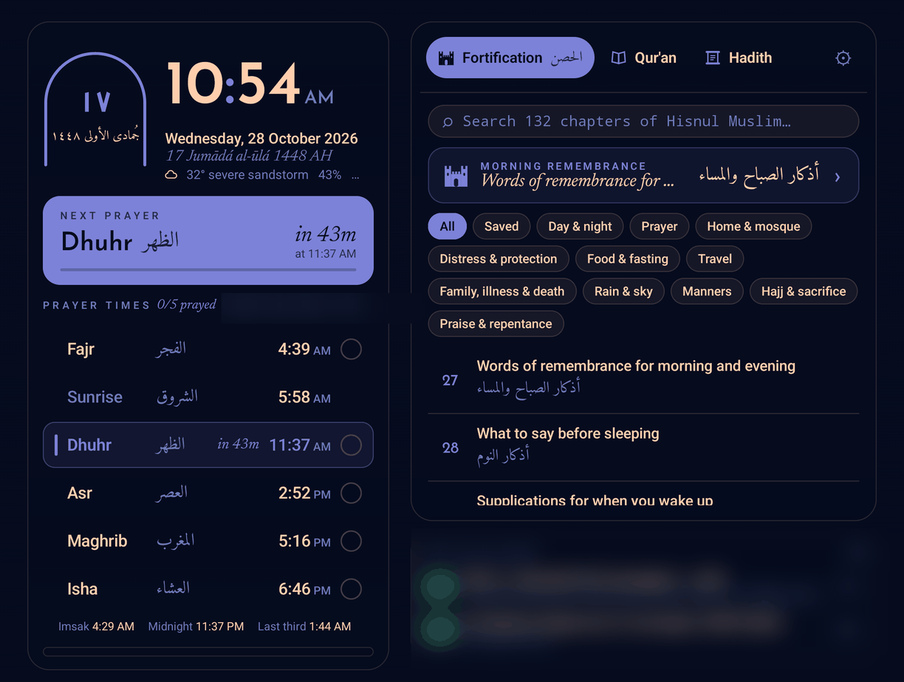

# Muslim Panel

A home-screen face for [Omalauncher](https://github.com/SimonSchubert/omalauncher), the Android launcher that runs Arch Linux. It puts the day's prayer times under the clock, and beside them three tabs: **Fortification** (the duas of *Hisnul Muslim*), a **Qur'an** verse of the day and a **hadith** of the day.



It's written in OWL, Omalauncher's widget language, as one file: [`muslim-panel.owl`](muslim-panel.owl).

A [Bustan Works](https://github.com/bustanworks) project, alongside [Majālis al-'Ilm](https://majalisalilm.netlify.app).

## Install

**From the store:** long-press empty space on your home screen, open the **store**, and find *muslim-panel* under Faces. (Once it's listed; see [Status](#status).)

**By hand:** copy `muslim-panel.owl` into `~/.config/omalauncher/widgets/` in the launcher's Arch system:

```sh
curl -fsSL -o ~/.config/omalauncher/widgets/muslim-panel.owl \
  https://raw.githubusercontent.com/bustanworks/muslim-panel/main/muslim-panel.owl
```

It shows up within seconds as a face left of your first home page; swipe right from page 1 to reach it, and move it in settings › pages. It runs no Linux commands, so it also works without Linux installed.

## What's on it

### Left: the clock and the prayers

- **The arch** holds the Hijri day in Arabic numerals with the month and year. Tap it for settings.
- **The clock**, the Gregorian and Hijri dates, the weather, battery and your next alarm (tap the alarm to open your clock app).
- **Next prayer**: its name in English and Arabic, a countdown, and a bar for how much of the time since the last prayer has passed.
- **The day's prayers**, with the coming one highlighted and counting down. Tap the circle beside a prayer to mark it prayed; the count shows as *3/5 prayed* and starts over each day.
- **Imsak, midnight and the last third of the night**, for fasting and tahajjud.
- **A dock** of six apps: tap **+** to choose which, long-press an icon to pin or unpin it, and **⌕** opens the app drawer.

### Right: three tabs

| Tab | What it holds |
|---|---|
| **Fortification** (الحصن) | All 132 chapters of *Hisnul Muslim* (*Fortress of the Muslim*) by Sa'id ibn Wahf al-Qahtani. Search them, or browse 11 categories: day and night, prayer, home and mosque, distress and protection, food and fasting, travel, family, illness and death, rain and sky, manners, Hajj and sacrifice, praise and repentance. |
| **Qur'an** (القرآن) | A verse a day in Arabic with Saheeh International's translation. *Another verse* draws a new one; *Read the surah* opens it on quran.com. |
| **Hadith** (الحديث) | A hadith a day, in Arabic and English, from an-Nawawi's Forty, Hadith Qudsi, Sahih al-Bukhari or Sahih Muslim. |

**In Fortification:**

- A card at the top suggests what fits the hour: the **morning** remembrances from Fajr to Dhuhr, the **evening** ones from Asr to Isha, **before sleeping** after Isha, and **after the prayer** in between.
- Open a chapter to read each dua in **Arabic**, its **transliteration** and its **English translation**.
- **Tap a dua when you've said it.** One said three or 33 times counts up to its number (*1 / 3*), then shows ✓. The chapter shows how many are done (*4/24*), ↺ starts it over, and long-pressing a dua resets that one. Counts start over each day.
- **Long-press a chapter** (or tap ☆ in it) to save it; saved chapters are under *Saved*.
- Chapters you've opened stay on the phone, so your morning and evening adhkar work offline.

Notifications sit under the tabs: tap one to open it, long-press to dismiss it.

## Looks

Choose one under **Appearance** in settings.

| Parchment | Night | Theme & wallpaper |
|---|---|---|
| Paper, ink and maroon, with a faint geometric pattern. The default. | The same design at night: deep navy, cream and a brighter maroon. | Your Omarchy theme's colours over your own wallpaper, on frosted glass that follows the home screen's tile opacity and blur. Changes with your theme. |

<p>
  
  
</p>

Night is on the left, Theme & wallpaper on the right. (In a screenshot there's no wallpaper behind the glass; on the phone yours shows through.)

The type follows the same design: **Reem Kufi** for the clock and headings, **Amiri** for Arabic, **Newsreader** italic for the dates and translations, and **Instrument Sans** for everything else.

## Settings

Tap the arch or ⚙ to open them, and **Done** to close them (they also close by themselves after two minutes).

- **Appearance:** Parchment, Night or Theme & wallpaper
- **Location:** automatic (from your network) or a city you search for
- **Calculation method:** Umm al-Qura (the default), Dubai, Gulf, Muslim World League, Egypt, ISNA, Karachi or Diyanet
- **Asr:** Shafi'i, Maliki and Hanbali, or Hanafi
- **Hijri date:** move it up to two days either way, to match your local moon sighting
- **Display:** a 24-hour clock, and transliteration on or off

## Layout

Unfolded or in landscape, the prayers sit on the left and the tabs on the right. On a narrow screen (a folded phone, say), the clock and next prayer go on top, the tabs below and the dock at the bottom. While you type, the parts that don't fit step aside so the keyboard doesn't cover the field.

## Privacy

Everything you set or mark stays on your phone, in the launcher's own storage: your city, the prayers you've marked, your dua counts and saved chapters. Nothing is sent anywhere except the requests that fetch the data below, and none of them carry anything about you beyond your location for the prayer times and weather. There are no accounts, keys or tracking.

## Where the data comes from

| What | Source |
|---|---|
| Prayer times and Hijri dates | [Aladhan](https://aladhan.com) |
| Hisnul Muslim | [hisnmuslim.com](https://www.hisnmuslim.com) |
| Qur'an, Arabic and Saheeh International | [alquran.cloud](https://alquran.cloud) |
| Hadith | [fawazahmed0/hadith-api](https://github.com/fawazahmed0/hadith-api) |
| Weather and automatic location | [wttr.in](https://wttr.in) |
| City search | [Open-Meteo geocoding](https://open-meteo.com) |
| Fonts | [Google Fonts](https://fonts.google.com) (SIL Open Font License) |

The look comes from [Majālis al-'Ilm](https://majalisalilm.netlify.app), Bustan Works' bilingual lecture archive.

## Status

Submitted to the [Omalauncher widget store](https://github.com/SimonSchubert/omarchy-widgets), where faces are reviewed before they're listed.

## License

[MIT](LICENSE), © 2026 Bustan Works. The duas, verses and hadith are the work of their authors and translators, served by the sources above.
